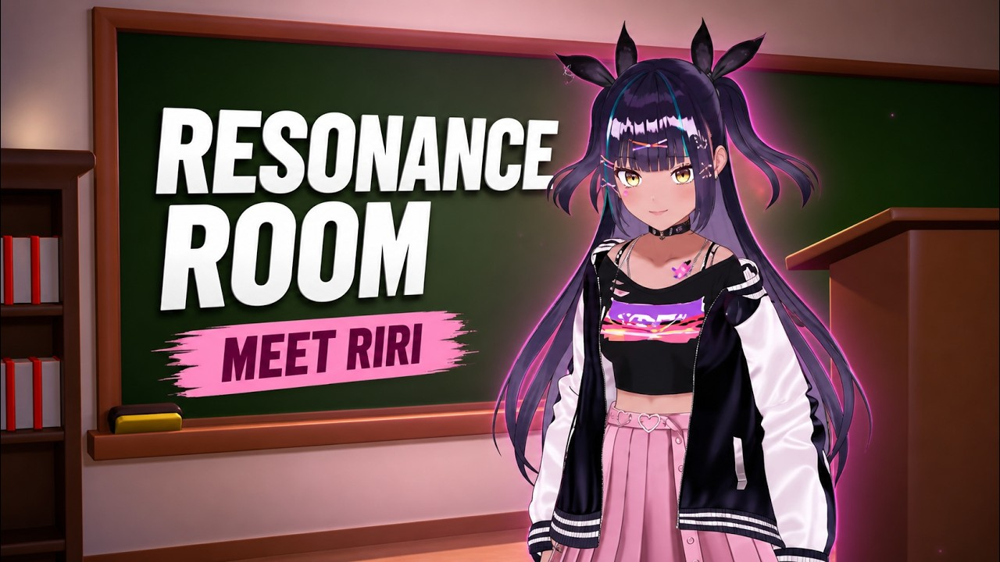
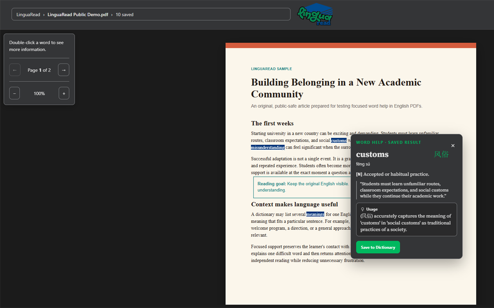
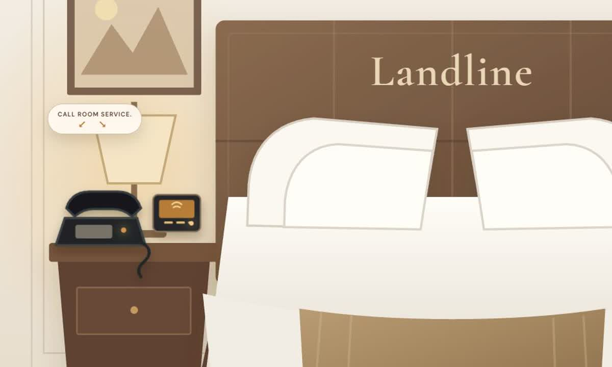
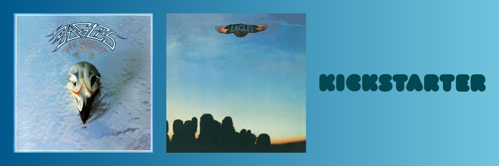

I build things I want to exist—interactive experiences, useful tools, and occasionally something strange. I use AI throughout the process to explore ideas, build, test, and refine them.

## Selected projects

### Resonance Room

Explore a 3D classroom and find music for your mood.

[Try it](https://resonance-room-web.onrender.com/) · [Watch the demo](https://youtu.be/O3GUOC3G2SA) · [Source](https://github.com/antunishdPursuit/resonance-room)

### LinguaRead

Read English PDFs with contextual Mandarin word help and a saved dictionary.

[Watch the demo](https://youtu.be/fouIw9q5ms0) · [Source](https://github.com/antunishdPursuit/linguaread)

### Landline

An in-room hotel concierge experience, from a bedside phone to a staff dashboard.

[Try it](https://landline-eta.vercel.app/) · [Watch the demo](https://youtu.be/BWhnnXPAScE) · [Source](https://github.com/antunishdPursuit/Landline)

## In progress

- [Personal website](https://github.com/antunishdPursuit/personal-website) — my current priority: bringing the projects, videos, and stories together.
- [Marele](https://github.com/antunishdPursuit/marele) — building toward a character who inhabits a room and responds through meaningful actions and conversation.

## Open-source contributions

Current contribution work: [MoltNet](https://github.com/getlarge/themoltnet/pull/2821) and [Integer Mult Bounds](https://github.com/antunishdPursuit/integer-mult-bounds).

## Away from the keyboard

The Eagles on repeat. Kickstarter superbacker. Always another idea to try.

